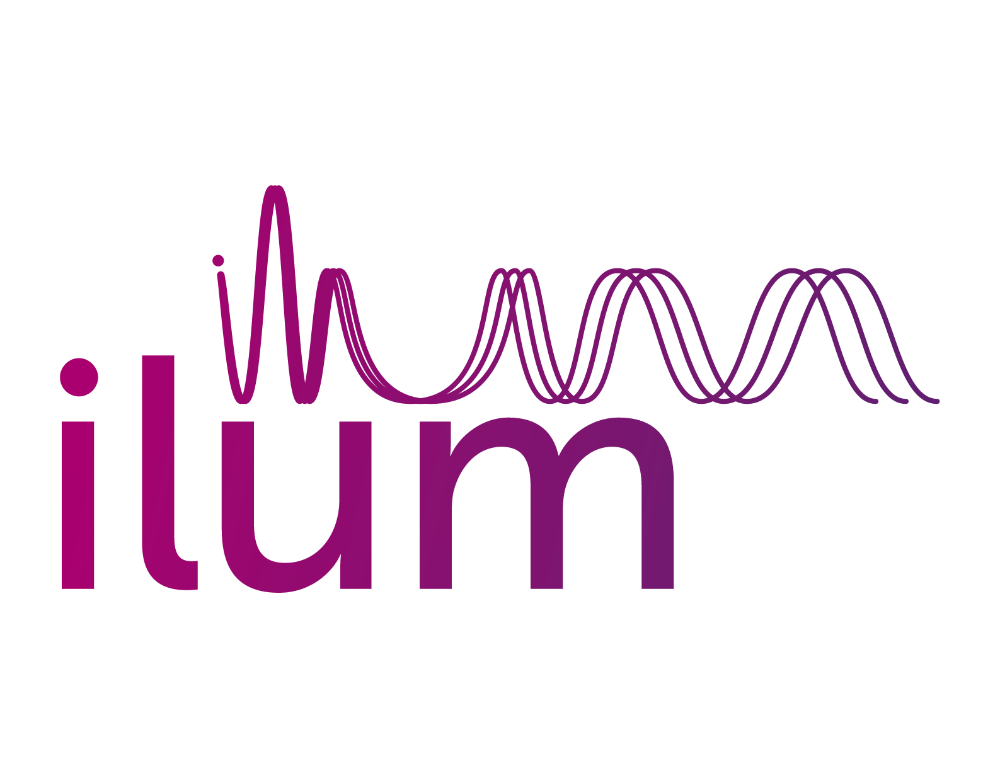

<!-- Profile README · matheuslmds -->

  

<h3 align="center">Science &amp; Technology Undergraduate · Scientific Computing</h3>

  

  

  

  <a href="https://www.ilum.cnpem.br/">Ilum School of Science — CNPEM</a> · Brazil

  

  
  
  
  

  
  
  

## About Me

I am an undergraduate student in Science and Technology at Ilum School of Science (CNPEM), Brazil, interested in understanding physical phenomena through mathematical modeling, numerical simulations, and scientific computing.

My academic interests span condensed matter physics, computational materials science, applied mathematics, and machine learning for scientific applications. I have previous research experience in first-principles calculations using Density Functional Theory (DFT) and VASP.

I aim to combine theoretical foundations, computational methods, and data-driven approaches to investigate physical systems and contribute to reproducible scientific research.

## Research Experience

Junior Scientific Initiation Scholarship — CNPq
Condensed Matter Physics · IFTM — Federal Institute of Triângulo Mineiro

During my final year of high school, I received a CNPq Junior Scientific Initiation scholarship to conduct research in computational condensed matter physics.
- Performed first-principles simulations based on Density Functional Theory (DFT) using the Vienna Ab initio Simulation Package (VASP).
- Investigated molecular and material systems, including H₂, O₂, graphene, and triphosphates.
- Developed an interest in atomistic simulations, electronic structure calculations, and computational approaches to materials research.
  
## Featured Projects

<table>
  <tr>
    <td width="40%" align="center" valign="middle">
      
    </td>
    <td valign="top">
      <h3><a href="https://github.com/matheuslmds/Tiamat">01 · Tiamat</a></h3>
      <b>Superconductivity Critical Temperature Prediction</b>
      
 

      
Predicts the critical temperature (Tc) of superconducting materials from chemical composition and elemental properties using the UCI Superconductivity Dataset (over 21,000 samples and 81 features).

      
Compares regression models, feature selection, hyperparameter optimization, cross-validation, and interpretability. Uses group-based data splitting to mitigate leakage between materials with identical chemical formulas.

      
<b>Tools:</b> Python, NumPy, Pandas, Scikit-learn, XGBoost, Optuna, SciPy, Matplotlib, SLURM and HPC.

      
    </td>
  </tr>
  <tr>
<td width="40%" align="center" valign="middle">
  
</td>
    <td valign="top">
      <h3><a href="https://github.com/matheuslmds/Ideal_gas_lab">02 · Ideal Gas Lab</a></h3>
      <b>Interactive Kinetic Theory Simulator</b>
      

        
        
      

      
An interactive two-dimensional particle simulator exploring the kinetic theory of gases through elastic collisions.

      
Allows users to control temperature and particle number, estimate temperature from mean kinetic energy, visualize particle velocities, and analyze velocity distributions in the context of Maxwell–Boltzmann statistics and thermal equilibrium.

      
<b>Tools:</b> Python, Pygame, Jupyter Notebook.

      
    </td>
  </tr>
  <tr>
    <td width="40%" align="center" valign="middle">
      
    </td>
    <td valign="top">
      <h3><a href="https://github.com/matheuslmds/biblioteca_real">03 · Esfinge</a></h3>
      <b>XGBoost Educational Notebook</b>
      
 

      
An individual contribution to <i>Biblioteca Real de Lumi</i>, a collaborative educational repository developed by students at Ilum School of Science.

      
Explores the mathematical foundations of XGBoost through theory, visualizations, and reproducible implementations. Applies and compares XGBoost, Decision Tree, and Random Forest models to the prediction of steel yield strength from chemical composition, including hyperparameter optimization.

      
<b>Tools:</b> Python, XGBoost, Scikit-learn, NumPy, Pandas, Matplotlib, Jupyter Notebook.

      
    </td>
  </tr>
</table>

---

## Research Interests

| Area | Topics of Interest |
| :--- | :--- |
| **Computational Physics** | Quantum mechanics, condensed matter physics, atomistic simulations, electronic structure theory |
| **Materials Science** | Structure–property relationships, superconductivity, computational materials science |
| **Applied Mathematics** | Numerical methods, mathematical modeling, optimization |
| **Machine Learning for Science** | Materials informatics, predictive modeling, model interpretability |

---

## Technologies & Tools
Programming Languages

  
  
  

## Scientific Computing & Data Science

  
  
  
  
  
  
  

## Machine Learning & Materials Informatics

  
  
  
  
  

## Development & Research Tools

  
  
  
  

## Currently Learning
- Mathematical foundations of computational physics and numerical analysis.
- Quantum mechanics and electronic structure theory.
- Scientific programming, optimization, and numerical simulations.
- Machine learning for materials science and materials informatics.

## GitHub Statistics

  
  

  

<!-- Optional: remove the comment delimiters to display contribution streaks as well.

  

-->

  <i>“Understanding nature through mathematics, physics, and computation.”</i>

  

